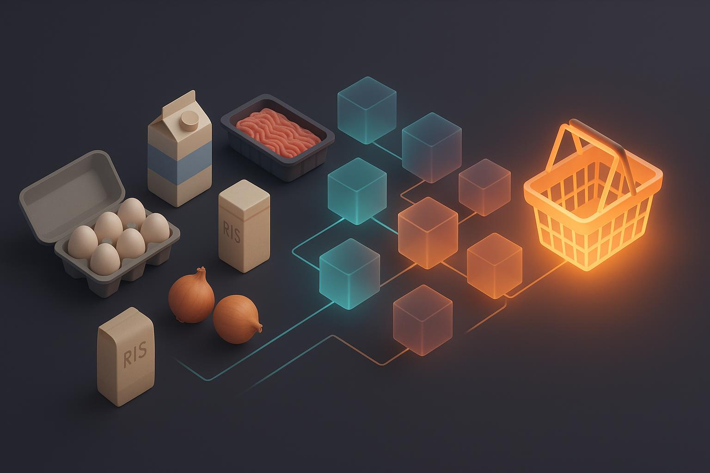
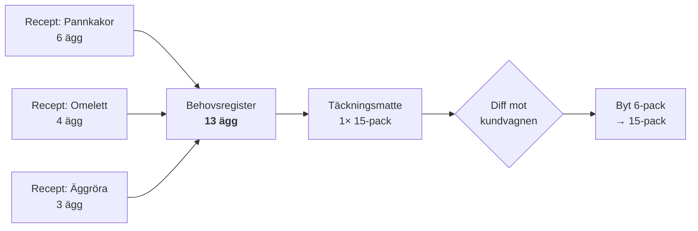

<div align="center">



<h1>willys-mcp</h1>

**Ge Claude dina recept. Få rätt varor, i rätt mängd, i din kundvagn — och veta var det är billigast.**

En MCP-server för Willys, Hemköp, Coop, City Gross och Mathem som gör svensk
matplanering till något du delegerar i stället för något du gör.

<br>


</div>

<br>

## Vad det här är

Ingen av de svenska matkedjorna har ett publikt API. Den här servern kartlägger
deras faktiska endpoints och exponerar dem som MCP-verktyg — sökning,
jämförprisrankning, prisjämförelse mellan kedjor, butiksregister, och för Willys
även inloggning, kundvagn och orderhistorik.

Men det intressanta ligger ovanpå: **kundvagnen behandlas som en projektion av
vad dina recept kräver.** Inte som en hög varor någon lagt i en gång. Och samma
plan kan prissättas i alla fem kedjor.

| Kedja | Sök & pris | Butik | Kundvagn & ordrar |
| --- | --- | --- | --- |
| Willys | ✅ | valfri, samma pris i hela landet | ✅ |
| Hemköp | ✅ | valfri, priser per butik | — |
| Coop | ✅ | **krävs**, välj via postnummer | — |
| City Gross | ✅ | valfri, smalnar av sortimentet | — |
| Mathem | ✅ | finns inte, en nationell prislista | — |

ICA stöds inte: deras API ligger bakom ett botskydd som tillåter ungefär fem
anrop per fem minuter, för lite för att planera en korg. Detaljer per kedja:
**[docs/kedjor.md](docs/kedjor.md)**.

<br>

## Se den göra något

> **Du:** Här är tre recept för veckan — pannkakor, omelett och äggröra.
>
> **Claude:** *(lägger till recepten, räknar om korgen)*
> Du behöver 13 ägg totalt. Billigast blir ett 15-pack för 36,81 kr — 2 ägg
> över. Jag har också hittat vispgrädde: 4× 2,5 dl för 43,52 kr täcker dina 8 dl.
>
> Summa 80,33 kr. Vill du att jag lägger det i vagnen?
>
> **Du:** Ja. Och lägg till en gratäng som behöver 5 dl grädde.
>
> **Claude:** *(behovet ändras, korgen räknas om)*
> Grädden går från 8 till 13 dl. Samma produkt är fortfarande billigast, så jag
> höjer antalet från 4 till 6 förpackningar — 65,28 kr. Äggen är oförändrade och
> rörs inte.

Servern har **inget kassaverktyg**. Den kan fylla kundvagnen men aldrig lägga en
order. Det sista klicket är alltid ditt.

> **Du:** Vad kostar pastan i de andra kedjorna?
>
> **Claude:** *(samma plan prissatt i fem kedjor, inget ändras)*
> Willys 61,30 kr · Coop Bäckebol 64,40 kr · Hemköp 69,35 kr · Mathem 70,10 kr ·
> City Gross 89,85 kr. Willys är billigast med 3,10 kr till Coop.

<sub>Riktiga priser från 2026-10-14: 500 g köttfärs, 400 g krossade tomater och 500 g spaghetti.</sub>

<br>

## Det svåra problemet: du kan inte köpa 13 ägg

Bara förpackningar av dem. Det låter trivialt och är det inte.

En vanlig prissökning rankar på jämförpris — kr per kilo, kr per liter, kr per
styck. Men när mängden är känd är det fel fråga. Det som avgör är vad *just ditt
behov* kostar när du bara kan köpa hela förpackningar.

| Strategi | Antal | Får | Över | **Kostnad** |
|---|---|---|---|---|
| 6-pack | 3× | 18 st | 5 | 74,70 kr |
| 10-pack | 2× | 20 st | 7 | 69,80 kr |
| **24-pack** | **1×** | **24 st** | **11** | **62,00 kr** ✅ |

<sub>Konstruerat exempel med satta priser, hämtat ur <a href="tests/coverage.test.ts">testsviten</a>. I Willys faktiska sortiment löses 13 ägg av ett 15-pack med bara 2 över — men principen är densamma.</sub>

24-packet vinner på riktiga pengar trots sämst antal spillda ägg. Servern räknar
igenom varje täckningsstrategi och rangordnar på total kostnad.

**Men den väljer inte åt dig när avvägningen är verklig.** Överstiger billigaste
vägen behovet med mer än 50 %, och finns ett märkbart tätare alternativ,
returneras en fråga i stället för ett beslut:

> Ägg 24-pack är 7,80 kr billigare men ger 11 st över behovet. Ägg 10-pack ger
> bara 7 st över. Vill du ha det billigare med överskott?

Det är hushållets avvägning, inte serverns. Rader med obesvarad fråga hamnar
aldrig i vagnen av misstag.

<br>

## Hur behoven hålls ihop



Varje recepts bidrag lagras separat. Det ger tre egenskaper som en löpande
summa inte kan ge:

- **Härkomst gratis.** 13 ägg är inte ett tal utan `Pannkakor:6 + Omelett:4 + Äggröra:3`.
  Claude kan förklara en ändring, inte bara meddela den.
- **Borttagning är en radering**, inte ett försök att subtrahera mängder som
  redan rundats upp till förpackningar.
- **Omräkning, inte lappning.** Hela korgen härleds ur registret varje gång.
  Det är därför 6-packet *byts ut* när behovet växer, i stället för att ett till
  staplas på.

`plan_apply` skickar bara differensen. Rätt vara i rätt antal ger inget anrop
alls, så det är gratis att köra om efter varje nytt recept.

<br>

## Verktyg

<table>
<tr><th align="left">Planering</th><th align="left"></th></tr>
<tr><td><code>plan_add_recipe</code></td><td>Lägg ett recepts ingredienser i registret — kedjeoberoende</td></tr>
<tr><td><code>plan_status</code></td><td>Föreslagen korg och kostnad i en kedja; <code>compareWith</code> prissätter samma plan i andra</td></tr>
<tr><td><code>plan_apply</code></td><td>Synka vagnen — <code>dryRun</code> som default</td></tr>
<tr><td><code>plan_set_ingredient</code> · <code>plan_remove_ingredient</code> · <code>plan_remove_recipe</code></td><td>Rätta en rad eller ett recept, räkna om</td></tr>
<tr><td><code>plan_clear</code></td><td>Nollställ planen</td></tr>
</table>

<table>
<tr><th align="left">Sök &amp; pris</th><th align="left"></th></tr>
<tr><td><code>compare_prices</code></td><td>Samma vara i flera kedjor i ett anrop: billigast per kedja och totalt</td></tr>
<tr><td><code>find_cheapest</code></td><td>Rankar på jämförpris över <b>hela</b> träffmängden i en kedja, serverside</td></tr>
<tr><td><code>search</code></td><td>Fritextsök i kedjans relevansordning</td></tr>
<tr><td><code>search_suggestions</code></td><td>Autocomplete</td></tr>
<tr><td><code>get_product</code></td><td>Näringsvärde, ingredienser, ursprung</td></tr>
<tr><td><code>get_campaigns</code></td><td>Butiksspecifika erbjudanden</td></tr>
</table>

<table>
<tr><th align="left">Kundvagn &amp; konto</th><th align="left"></th></tr>
<tr><td><code>get_cart</code> · <code>add_to_cart</code> · <code>remove_from_cart</code></td><td>Kundvagn (Willys)</td></tr>
<tr><td><code>get_orders</code> · <code>get_order_details</code></td><td>Orderhistorik (Willys)</td></tr>
<tr><td><code>get_frequent_products</code> · <code>get_customer_info</code></td><td>Vanligaste varor ur faktisk historik, kundprofil</td></tr>
<tr><td><code>login</code> · <code>check_auth</code> · <code>logout</code></td><td>Session per kedja, 24h</td></tr>
</table>

<table>
<tr><th align="left">Butik &amp; uppsättning</th><th align="left"></th></tr>
<tr><td><code>find_stores</code> · <code>get_store</code></td><td>Butiker på ort, postnummer eller koordinat; för Coop vilken butik som levererar till ditt postnummer</td></tr>
<tr><td><code>setup</code> · <code>setup_init</code> · <code>open_file</code></td><td>Guidad förstagångsuppsättning</td></tr>
<tr><td><code>read_doc</code> · <code>fetch_url</code> · <code>release_notes</code></td><td>Hjälp, recept från en länk, vad som ändrats sedan en version</td></tr>
</table>

Nästan alla verktyg tar `chain`. Claude frågar vilken kedja du handlar i om du
inte sagt det — servern väljer aldrig åt dig.

<br>

## Installation

```bash
npm install
npm run build
```

Koppla in i **Claude Code**:

```bash
claude mcp add willys --env WILLYS_HOME=$HOME/.willys-mcp -- node /absolut/sökväg/willys-mcp/dist/index.js
```

…eller i **Claude Desktop**:

```json
{
  "mcpServers": {
    "willys": {
      "command": "node",
      "args": ["/absolut/sökväg/till/willys-mcp/dist/index.js"],
      "env": { "WILLYS_HOME": "/Users/dittnamn/.willys-mcp" }
    }
  }
}
```

Sök, priser och jämförelser fungerar direkt, utan konto. För kundvagn och
orderhistorik hos Willys skriver du **"hjälp mig komma igång med Willys"** i en
chatt. Claude frågar vilken ort du handlar i, slår upp din butik, skapar
konfigurationsfilen och öppnar den åt dig. Det enda du gör själv är att fylla i
två rader.

`WILLYS_HOME` styr var `.env` och sessionsdatabasen hamnar. Utan den ligger de i
projektmappen, vilket är bekvämt i en checkout men gör att de följer med om
mappen någon gång byts ut.

Fullständig guide: **[INSTALL.md](INSTALL.md)**

> [!IMPORTANT]
> För kundvagnen måste ditt Willys-konto ha ett **lösenord**. BankID går inte att automatisera —
> servern loggar in genom att fylla i ett formulär. Har du bara använt BankID
> måste du skapa ett lösenord först, och Claude förklarar hur.

<br>

## Arkitektur

```
src/
├── index.ts          MCP-entrypoint: transport + wiring (tunn)
├── setup.ts          förstagångsdiagnostik
├── tools/            ett verktyg = ett objekt, grupperat per domän
│   ├── registry.ts   samlar grupperna, äger dispatch (validering, auth, felgräns)
│   ├── kit.ts        Tool-kontrakt, Ctx, defineTool, svarshjälpare
│   ├── session.ts · search-tools.ts · cart-tools.ts · orders-tools.ts
│   ├── stores-tools.ts · setup-tools.ts · planner-tools.ts
│   ├── schema-parts.ts  delade Zod-fragment
│   └── json-schema.ts   Zod → JSON Schema för manifestet
├── planner/
│   ├── ledger.ts     behovsregister med härkomst per recept
│   └── reconcile.ts  bygger korgen, diffar mot vagnen
├── chains/           ChainAdapter-kontraktet, registret, delad rangordning och butiksregister
├── domain/           ren matte: volym, täckning, produktmodell, namnmatchning, jämförpris
├── upstream/         HTTP-klienter, en mapp per plattform, en fil per resurs
│   ├── axfood/       Willys + Hemköp (samma API, två värdar)
│   ├── coop/         API-nycklarna läses ur coop.se vid första anropet
│   ├── citygross/
│   └── mathem/
├── auth/             Puppeteer-inloggning, sessionslagring
├── net/              generisk URL-hämtare (fetch_url)
├── core/             http, result, logger, env
└── constants/        endpoints, gränsvärden, instructions
```

En adapter per *plattform*, inte per butik: Willys och Hemköp är samma
Axfood-API, och skillnaden mellan dem är en bas-URL. Rangordning och filter
ligger i `chains/` och gäller alla kedjor lika.

`domain/` och `planner/ledger.ts` rör aldrig nätverket. Täckningsmatten och
behovsregistret är rena funktioner mot SQLite — vilket är varför de har riktiga
tester som kör på under en sekund utan att logga in någonstans.

<br>

## Designprinciper

Fem beslut som formar resten av kodbasen.

**Servern gissar aldrig tyst.** Filtreras varor bort står det hur många och
varför — djurmat, fel namn, ej köpbara. Matchar en kategorifacett ingenting görs om­försök utan den och svaret
säger vilka facetter som faktiskt finns. Ett tyst nollresultat är värre än ett
fel — det ser ut som att hyllan är tom.

**Beslut med verklig avvägning returneras som frågor.** Överskott mot pris är
inte serverns val. Samma sak när två recept vill ha `2 st tomat` och `400 g
tomat`: det blir en konflikt att lösa, inte en påhittad omräkning.

**Farliga tillstånd görs omöjliga i protokollet.** Det finns inget kassaverktyg,
så servern *kan* inte beställa. `plan_apply` har `dryRun: true` som default.
`setup_init` tar inte emot lösenord som argument — inte som en regel
modellen ska följa, utan för att schemat vägrar. Det är starkare än att skriva
"gör inte så".

**Zod validerar på riktigt.** MCP-SDK:n validerar *inte* argument mot schemat en
server annonserar — det är dokumentation, inte kontroll. Varje anrop parsas före
dispatch. Utan det går en påhittad `quantity` rakt in i kundvagnen, och för
`add_to_cart` betyder det riktiga varor.

**Fel bär en klass hela vägen ut.** `AUTH_EXPIRED`, `SHAPE`, `NOT_FOUND`,
`SETUP_REQUIRED`, `UPSTREAM`. Modellen kan skilja "sessionen dog" från "kedjan
ligger nere" från "en människa måste redigera en fil", och agera olika på varje.

**Servern rangordnar själv.** Bara Axfood sorterar rätt på jämförpris. City
Gross ignorerar kampanjpris, Mathem kan inte sortera alls, och Coop har
jämförpriser som är fel med en faktor tusen. Servern hämtar hela träffmängden,
kontrollerar jämförpriset mot pris ÷ förpackning och sorterar.

<br>

## Fällor som redan kostat tid

Dokumenterade i koden, med datum, så ingen återinför dem.

- `sort=price:asc` rankar en portionsrätt på 16 kr **över** ett kilo köttfärs på
  69 kr. Sortera på `compareprice:asc`.
- Facettfilter ligger i `q`, inte i en egen parameter: `q=köttfärs:category:Kött`.
  Utan kategorin är billigaste träffen på "köttfärs" en Findus köttfärssås.
- Fritextsök utan `mustContain` ger självsäkert nonsens. *"torkad dragon"*
  matchade ett torkat grisöra sålt som hundtugg — det var billigast med ordet
  "torkad".
- Näringsvärden ligger i `nutritionsFactList`, inte `nutritionFacts` (tom sträng
  på varje produkt som inspekterats).
- Willys svarar **400**, inte 404, för en produktkod som inte finns.
- Kundvagnen har ingen delete-endpoint. Borttagning är en add med `quantity: 0`.
- Varje endpoint som innehåller ett Next.js build-id är en tidsinställd bomb.
  Tre är redan döda och ligger kvar i `DEAD_ENDPOINTS` som varning.
- "köttfärs" hos Coop rankade kattmat först. Den var billigast av allt med kött.
- City Gross `totalCount` räknar recept som träffar: "köttfärs" ger 101 träffar
  och 9 produkter.
- Coop-sök mot en butik utan e-handel ger noll träffar, inte ett fel.
- City Gross produktkoder är Axfoods: samma kod är samma vara hos Willys, Hemköp
  och City Gross.

<br>

## Vad den inte gör

- **Beställer inte.** Inget kassaverktyg finns.
- **Fungerar inte i claude.ai i webbläsaren.** En webbsida kan inte starta
  program på din dator. Claude Desktop eller Claude Code.
- **Stödjer inte BankID.**
- **Stödjer inte ICA.**
- **Har ingen kundvagn för Hemköp, Coop, City Gross eller Mathem än.**
- **Är inte officiell.** Endpoints är kartlagda mot produktion och kan sluta
  fungera utan förvarning.

<br>

## Utveckling

```bash
npm run typecheck      # enda verkliga porten före commit
npm run test:coverage  # täckningsmatte, inget nätverk
npm run test:planner   # behovsregister, inget nätverk
npm run test:volume    # 44 verkliga förpackningsformat
npm run test:chains    # mappning per kedja, rangordning, djurmat, jämförpriskontroll
npm run test:coop      # Coops nyckelhämtning och rotation, med stubbad fetch
npm run test:releases  # release notes och tombstones för gamla verktygsnamn
npm run smoke          # end-to-end över stdio, kräver session
```

Konventioner och fallgropar för framtida ändringar: **[CLAUDE.md](CLAUDE.md)**
Endpoint-kartläggning: **[docs/kedjor.md](docs/kedjor.md)** · Willys i detalj: **[docs/endpoints.md](docs/endpoints.md)**
Ändringar per version: **[docs/CHANGELOG.md](docs/CHANGELOG.md)** — AI-klienter läser samma fil via `release_notes`.

<br>

## Förbehåll

Ett privat verktyg som automatiserar ett konto du själv äger och läser publika
priser. Respektera kedjornas användarvillkor, kör det inte mot konton du inte
förfogar över, och undvik anropsvolymer som liknar skrapning.

<br>

---

<div align="center">

**MIT** · [LICENSE](LICENSE)

</div>
